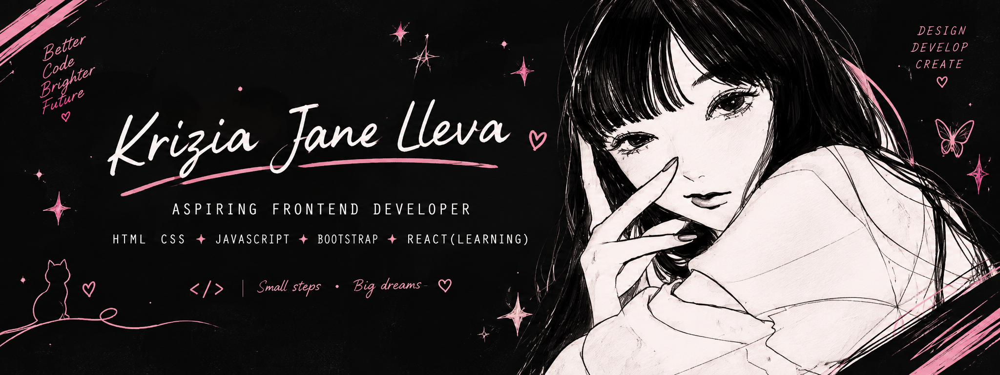

<!--
  GitHub Profile README
  Theme: Charcoal Black • White • Soft Pink
  Username: nishiriks
-->

  

   

  <h1>🎀 Hi, I'm Krizia Jane Lleva 🎀</h1>

  <h3>♡ Aspiring Frontend Developer ♡</h3>

  
<i>Building thoughtful digital experiences, one line of code at a time.</i>

   

---

## 🎀 About Me

Hello! I'm a BS Information Technology graduate from Centro Escolar University – Malolos, with a passion for frontend development and web design.

I enjoy transforming ideas into responsive websites and user-friendly applications. I value thoughtful design, clean code, and continuous improvement as I grow in the field of web development.

- 🎓 **Education:** BS Information Technology (2022–2026)
- 🎀 **Academic Achievement:** Magna Cum Laude
- 💻 **Career Focus:** Frontend Development
- 🌷 **Interests:** Web Design, Responsive Interfaces, and UI/UX
- 🌱 **Currently Improving:** JavaScript and modern web development
- ✨ **Goal:** To contribute to meaningful projects and continue growing as a developer

> ♡ Small steps, build big dreams. ♡

---

  <h3>🌸 Tech Stacks and Tools 🌸</h3>
  
  

  
  

  <i>The technologies I use in my projects and coursework.</i>

  

    
     
    
  

  

---

## 🎀 GitHub Statistics

  

  

  

---

## ୨୧ Certifications & Achievements

- 🎓 **Magna Cum Laude** — BS Information Technology
- 📜 **TESDA National Certificate II — Computer Systems Servicing (CSS)** *(include only if this accurately describes your credential)*

Add other relevant certifications, workshops, or technical achievements as applicable.

---

## ୨୧ Let's Connect

I'm open to connecting with fellow developers, collaborating on projects, and exploring opportunities to grow professionally.

  
  
  

   

  <i>♡ Always learning · Always building · Always improving ♡</i>

    

  **Thank you for visiting my profile!**

  Made with ♡ and a little pink.

